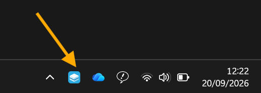
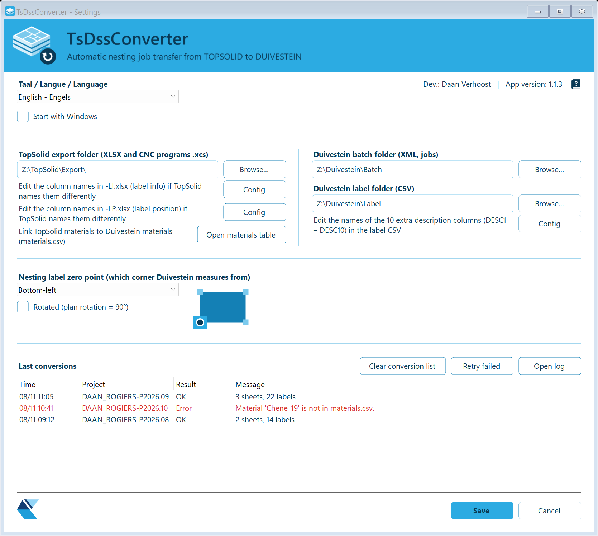
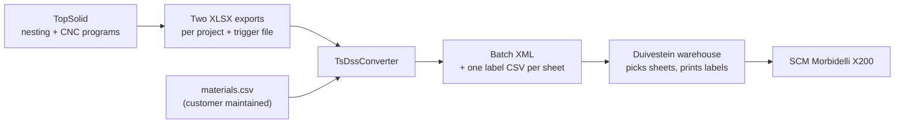

<h1 align="center"></h1>

**Automatic nesting job transfer from TopSolid to the Duivestein panel warehouse.**

TsDssConverter is a small Windows tray application. It watches the folder where TopSolid exports its nesting jobs and turns
every finished job, without any manual work, into a batch job for the Duivestein automatic warehouse.
Sister tool: **[DssLabelTemplate](https://github.com/Ruu-D/DssLabelTemplate)** (view, edit and reprint the labels).

> **Status:** version **2.0.1** (2026-11-22): the advanced settings can now be changed in the window, in the *Magic
> parameters* (see below); since 2.0.0 the window and the icons have the "Maestro" look of the machine software, like
> DssLabelTemplate 2.0.0. In use at the customer since version 1.1.0 (2026-10-24); the real-world tests with the
> warehouse and the machine are going on. Full history: [CHANGELOG.md](CHANGELOG.md).

## At a glance

- **One file**, `TsDssConverter.exe`: no installer, no .NET installation, no Excel or Office. It lives in `C:\TsDssConverter\`,
  together with its settings, the materials table and the log files. Uninstalling = deleting that folder.
- **Works silently** in the Windows tray. Only when a job fails: one notification and a red icon. The window shows the
  status of the program, a countdown to the next scan and the last conversions.
- **Dutch, French and English** interface.
- **Strict on purpose:** it never guesses a material, never overwrites a job and never lets the warehouse see half a job.

## What it looks like

The program lives in the Windows tray, next to the clock. Double-click the icon to open the settings window.

  

  

## Why this tool exists

At the customer, panels are nested and programmed in **TopSolid** (CAD/CAM) for an **SCM Morbidelli X200** CNC machine. The
boards are handled by a **Duivestein automatic warehouse**, which picks each sheet, prints and places its labels, and pushes
the sheet onto the machine. The warehouse needs a *batch job* (XML) that says which sheets to pick, which labels to print and
where each label goes. **TopSolid does not produce that format: TsDssConverter is the missing link.**

## How it works

1. TopSolid writes two XLSX files per project (label information `-LI` and label positions `-LP`), the CNC programs in a
   folder named after the project, and a trigger file `-TR` as the very last one.
2. When the trigger file appears, the program converts the project: it joins the two exports per part, translates the
   TopSolid material names with `materials.csv`, and writes **one batch XML** (one plan per material) and **one label CSV per
   sheet** (position, rotation, dimensions, edge banding and other data for the label layout).
3. The CNC programs are moved to `CNC\<project>\` and the XLSX files to `_Converted\` (folder names follow the language), so
   the export folder only holds what is not converted yet.
4. If something is wrong with a job, its files go to `_Error\` with a `fout.txt` that explains in plain language what to
   correct. Once fixed, **Retry failed** puts them back for a new attempt. A network drive that is not there yet only
   delays the job: it is retried by itself.

The sample project in [`samples/`](samples/) (22 parts) becomes one batch XML with 2 plans and 3 label files; the expected
output is in [`samples/duivestein/`](samples/duivestein/).

## Built to be safe

A wrong job means a wrong board or a wrong program on the machine, so the tool refuses rather than repairs:

- **No guessed materials:** an unknown material, an empty one or two materials on one sheet stop the job, with the name.
- **No overwritten jobs:** if the batch already exists in the warehouse folder, nothing is written.
- **No mixed-up CNC programs:** each project's programs stay in a folder of their own.
- **Never half a job:** label files first, batch XML last, each file renamed into place only when complete.
- **Every problem at once,** in plain language, naming the part or column. Small issues are warnings only.

## Main milestones

| Version | Date | |
|---|---|---|
| 1.0.0 | 2026-09-20 | First complete version: conversion, all checks, tray application, folder watching, one-file delivery |
| 1.0.3 | 2026-09-21 | Batch XML in the format accepted by Duivestein's DSSClient |
| 1.1.0 | 2026-10-24 | **First customer release**, with the redesigned settings window |
| 1.1.1 | 2026-10-30 | Fixes from the first real customer exports (material from TopSolid's *Matériau* column) |
| 1.1.2 | 2026-11-04 | CNC programs read from a folder per project, as agreed with TopSolid |
| 1.1.3 | 2026-11-08 | `settings.json` can be edited while the program runs (see below); banner in the style of DssLabelTemplate |
| 2.0.0 | 2026-11-22 | Settings window and icons in the "Maestro" look of the machine software (the same as DssLabelTemplate 2.0.0): the status of the program with a countdown to the next scan, scan / pause / retry / material-list buttons, a folders panel that folds up, and a language switch that works at once |
| 2.0.1 | 2026-11-22 | *Magic parameters*: the advanced settings in a popup behind a cog, so nobody has to edit `settings.json` |

## Advanced settings (*Magic parameters*)

The folders, language and zero point are set in the window. A few advanced settings are stored in
`C:\TsDssConverter\settings.json`. Since 2.0.1 the **cog** at the top right of the window opens them in a small popup, the
*Magic parameters* (the window behind it is dimmed), so nobody has to edit the file; the popup changes only
these values in the file. Up to 2.0.0 they could only be edited in the file itself (Shift+click on the ROGIERS logo). A
change is used at once, without a restart.

| Setting | Default | Meaning |
|---|---|---|
| `CncExtension` | `.xcs` | File extension of the CNC programs |
| `CncPathPrefixInXml` | empty | Replaces the export folder in the CNC paths of the batch XML (e.g. a `\\server\...` path) |
| `CsvEncoding` | `utf-8` | Encoding of the label CSV files |
| `RescanSeconds` | `30` | How often the export folder is scanned besides the file events (5 – 3600) |
| `RequireTriggerFile` | `true` | Wait for the `-TR` file before converting |

The TopSolid column names and the extra label columns are set with the *Config* buttons, the materials with
*Material list* (the round button at the right of the blue bar).

## Open points

| From | Question | Status |
|---|---|---|
| Physical test sheet | Compare our label with the one Duivestein's own software (*PrintServer*) prints automatically: some printed elements come out differently (arrows, the rotation of the edge-banding information, underlining and other font styles). Also which point of the label the position refers to, the rotation direction, and how square and non-square labels are turned. | **Open** |
| TopSolid | Deliver the agreed folder per project for the CNC programs (`<export>\<project>\<sheet>.xcs`, agreed 2026-11-04) | **Resolved** (2026-11-22): TopSolid delivers it |
| Duivestein | What happens when a batch is sent twice, and an import test of the label CSVs | **Resolved** (2026-11-22): a batch that is already present is ignored by Duivestein; the label import works perfectly |

## Technology

C# on .NET 10 with Windows Forms; [ClosedXML](https://github.com/ClosedXML/ClosedXML) reads the XLSX files (no Excel needed).
492 automated tests (xUnit) cover the conversion, every error and warning, the window at several screen scalings and all three
languages; the sample converts byte for byte to the expected files.

## Credits

Developed by Daan Verhoost, together with my best friend Claude AI for [ROGIERS NV/SA](https://www.rogiers.be/).
